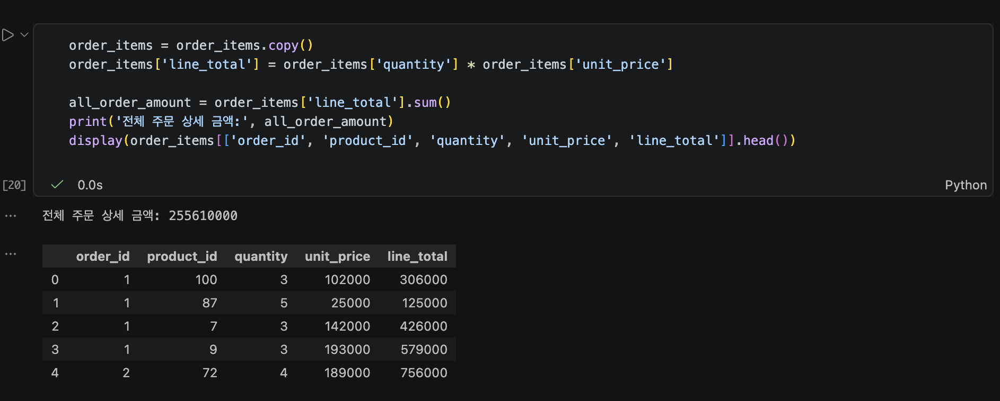
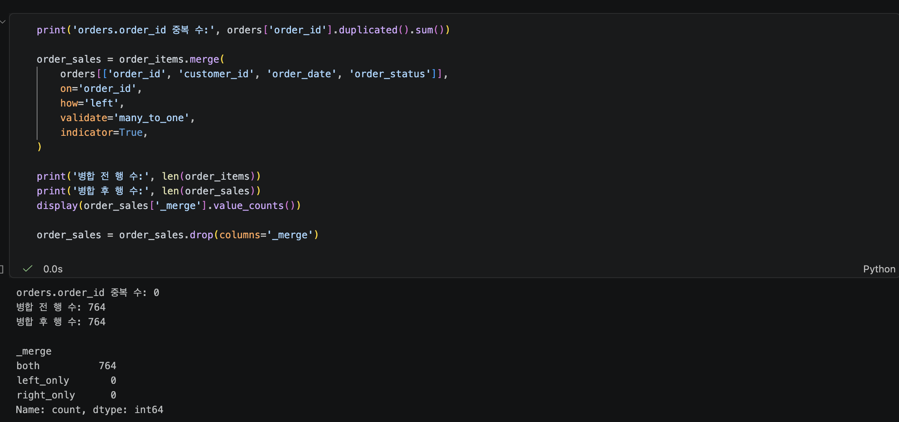
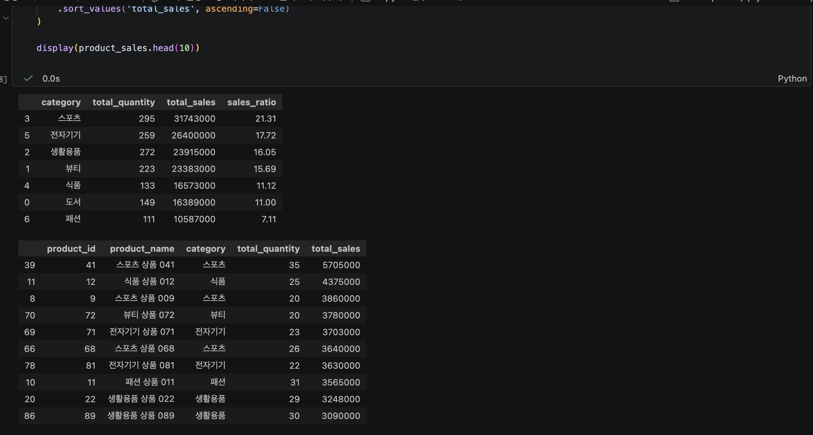
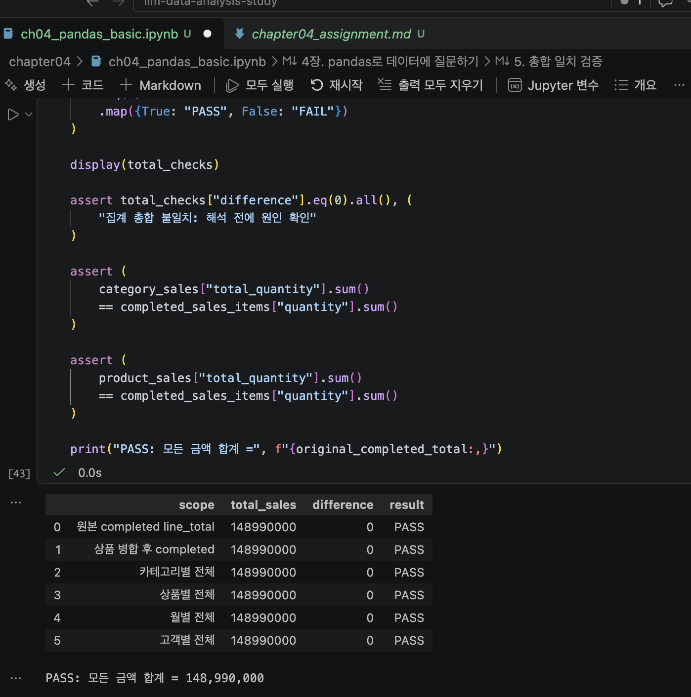
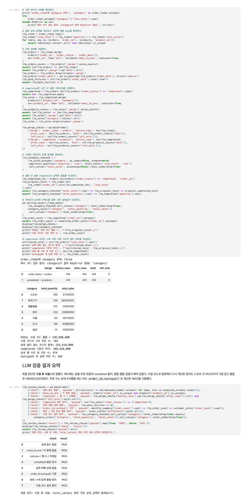

# Chapter 04 제출 답안 양식. pandas로 데이터에 질문하기

> 주 제출물은 실행 완료 Notebook `chapter04/chapter04.ipynb`입니다. 이 양식의 항목을 Notebook의 Markdown 셀로 추가해 작성합니다.

## 0. 제출 정보
- 이름: (제출 전 입력)
- GitHub ID: HauserNR
- 작성일: 2026-10-07
- 최종 제출 URL: https://github.com/HauserNR/llm-data-analysis-study/blob/main/chapter04/chapter04.ipynb

## 1. 질문과 필요한 데이터 선택
### 내가 확인하려는 질문

어떤 상품 카테고리의 completed 주문 기준 금액이 가장 큰가?
완료된 주문의 상품 금액을 카테고리별로 더해서 비교했다.

### 사용한 파일/컬럼

금액 계산에는 order_items.csv의 quantity와 unit_price를 사용했다.
이 파일에는 주문 상태와 카테고리가 없어서 orders.csv의 order_status와 products.csv의 category를 연결했다.
주문은 order_id, 상품은 product_id로 연결했다. order_item_id는 상세 행이 중복되지 않았는지 확인할 때 사용했다.
상품별 결과에는 product_name을, 월별 결과에는 order_date를 사용했다.
고객별로는 customer_id를 기준으로 집계한 뒤 customers.csv에서 city만 가져왔다.
추가 실습에서는 고객의 gender·age, 상품의 price, 주문의 payment_method도 사용했다.

### 결과 관찰

CSV를 읽어 보니 고객은 150행, 상품은 100행, 주문은 300행, 주문 상세는 764행이었다.
주문 상태는 completed 184건, cancelled 64건, refunded 52건으로 나뉘어 있었다.

### 나의 해석과 판단

한 주문에 상품이 여러 개 들어갈 수 있으므로 주문 수와 상세 행 수를 구분했다.
이번 질문은 완료 주문 기준이기 때문에 cancelled와 refunded는 제외했다.
금액도 상품 목록의 price가 아니라 주문 상세에 기록된 unit_price로 계산했다.
연령이나 도시로 고객을 제한하면 전체 완료 주문에 대한 결과가 아니게 되므로, 그 조건은 필터 연습에만 사용했다.

### 업무·분석적 의미

이렇게 집계하면 완료 주문 금액에서 어느 상품군의 비중이 큰지 알 수 있다.
카테고리별 상품 운영을 검토할 때 먼저 살펴볼 대상을 정하는 데 쓸 수 있다.

### 한계와 추가 확인 사항

가상 쇼핑몰 데이터이므로 실제 기업의 실적을 설명하는 자료는 아니다.
원가와 할인, 세금, 배송비도 없어서 이 계산만으로 순매출이나 이익을 알 수는 없다.

## 2. 필터링·정렬·파생 컬럼
- 적용한 필터 조건: order_status == "completed". 연령·도시 조건은 별도 연습에만 사용했다.
- 정렬 기준: 카테고리·상품·고객은 total_sales가 큰 순서로, 월별 결과는 날짜순으로 정렬했다.
- 만든 파생 컬럼: line_total, order_month, sales_ratio, average_order_value, customer_label.
- `line_total` 계산식: quantity × unit_price.



### 결과 관찰

첫 상세 행은 수량이 3, 단가가 102,000이어서 line_total이 306,000으로 계산됐다.
전체 주문 상세 금액은 255,610,000이었다. completed만 남기니 주문 184건, 상세 474행이 남았고 금액은 148,990,000이었다.
날짜 변환에 실패한 행은 없었다.

### 나의 해석과 판단

completed 조건을 빼면 금액이 106,620,000 더 커진다.
계산식이 같아도 어떤 주문을 포함하느냐에 따라 결과가 달라지므로, 이후 집계에서도 같은 필터를 유지했다.

### 업무·분석적 의미

전체 주문 금액과 완료 주문 금액을 따로 보면 취소·환불 주문이 섞인 수치를 구분할 수 있다.
결과를 전달할 때도 어떤 상태까지 포함했는지 함께 적어야 금액을 잘못 이해하지 않을 수 있다.

### 한계와 추가 확인 사항

전체 금액과 완료 주문 금액의 차이는 cancelled 62,181,000과 refunded 44,439,000을 더한 값과 같았다.
여기서 계산한 것은 제외한 주문의 상품 금액이다. 실제로 환불한 돈이나 손실액을 계산한 것은 아니다.

## 3. merge 검증
- 병합한 데이터: order_items에 orders를 연결하고, 완료 주문 상세에 products를 연결했다. 고객별 집계에는 customers의 city를 붙였다.
- 사용한 key: 주문은 order_id, 상품은 product_id, 고객은 customer_id.
- `validate` 결과: 주문·상품 병합은 many_to_one, 고객 속성 병합은 one_to_one을 통과했다. 오른쪽 key의 중복은 모두 0건이었다.
- `indicator` 결과: both는 주문 764행, 상품 474행, 고객 100행이었다. left_only와 right_only는 모두 0행이었다.
- 병합 전/후 행 수: 주문 764→764행, 상품 474→474행, 고객 100→100행.



### 결과 관찰

세 번의 병합 모두 행 수가 그대로였고 연결되지 않은 행도 없었다.
병합 후에도 order_item_id는 중복되지 않았다. 상세가 없는 주문도 없었다.

### 나의 해석과 판단

상세 테이블에는 같은 order_id가 여러 번 나왔지만 orders에서는 중복이 없었다.
한 주문에 여러 상품이 들어 있는 구조이므로 상세 쪽의 반복은 그대로 두고, orders 쪽의 key가 고유한지 확인했다.
행 수와 금액도 유지되어 병합 때문에 같은 상세가 늘어나거나 빠지지는 않았다고 판단했다.

### 업무·분석적 의미

주문 테이블의 key가 중복되면 같은 상품 금액이 여러 번 더해질 수 있다.
반대로 연결되지 않은 상세를 버리면 금액이 빠진다. 병합 결과를 확인해야 이런 계산 오류를 찾을 수 있다.

### 한계와 추가 확인 사항

ID가 연결됐다고 해서 상품 정보까지 정확하다는 뜻은 아니다.
예를 들어 카테고리가 잘못 입력돼 있어도 총합은 같을 수 있다. 카테고리별 결과를 판단하려면 상품 정보도 정확해야 한다.

## 4. completed 주문 범위와 집계
- 분석 범위 정의: 완료 주문 184건의 상세 474행. 해당 주문에서 구매된 상품은 98개, 고객은 100명이었다.
- 카테고리별 결과: 스포츠가 total_sales 31,743,000, total_quantity 295개로 가장 높았다. 전체 금액의 21.31%였다.
- 상품별 결과: 스포츠 상품 041이 total_sales 5,705,000, total_quantity 35개로 금액 1위였다.
- 월별 결과: 2026년 4월이 total_sales 16,634,000, order_count 20건으로 금액 1위였다.
- 고객별 결과: Customer 117이 total_sales 4,100,000, order_count 5건으로 금액 1위였다.



### 결과 관찰

카테고리별 금액은 스포츠가 가장 컸고 전자기기가 26,400,000으로 두 번째였다. 패션은 10,587,000으로 가장 작았다.
4월과 7월은 주문 수가 20건으로 같았지만 금액은 각각 16,634,000과 14,639,000이었다.
금액이 높은 고객 10명의 합계는 34,694,000으로 전체의 23.29%를 차지했다.

### 나의 해석과 판단

처음 질문에 대한 답은 스포츠였다. 수량도 295개로 가장 많았다.
다만 금액은 수량과 단가를 곱한 값이므로 많이 팔린 영향과 가격의 영향을 나눠 봐야 한다.
월별 결과에서도 주문 수가 같아도 금액이 달랐다. 주문 건수만으로는 구매 규모를 충분히 설명할 수 없었다.

### 업무·분석적 의미

스포츠 상품 중 어떤 상품이 금액을 많이 차지했는지 살펴보면 상품 운영을 검토할 대상을 좁힐 수 있다.
월별로는 주문 수와 주문당 금액을 함께 보고, 고객별로는 재구매 기록을 추가해 구매 패턴을 살펴볼 수 있다.

### 한계와 추가 확인 사항

total_sales는 완료 주문의 quantity × unit_price를 더한 값이다. 할인·세금·배송비 등의 처리를 확인하지 않았으므로 회계상 순매출이라고 부를 수는 없다.
원가가 없어 이익도 알 수 없고, 금액이 가장 크다는 이유만으로 가장 인기 있는 카테고리라고 단정할 수도 없다.
처음과 마지막 달인 2025년 9월과 2026년 9월은 한 달 전체가 포함되지 않아 다른 달과 단순 비교하기 어렵다.

## 5. 총합 일치 검증
- 원본 completed `line_total` 합계: 148,990,000.
- 카테고리 합계: 148,990,000.
- 월별 합계: 148,990,000.
- 고객별 합계: 148,990,000.
- 차이 여부: 모든 합계가 같았고 원본 대비 차이는 0이었다.



### 나의 해석과 판단

집계 기준만 바꾼 것이므로 포함된 주문이 같다면 총합도 같아야 한다.
원본 상세에서 completed 주문 ID에 해당하는 행만 골라 기준 금액을 구했다.
카테고리·상품·월·고객별 합계가 모두 148,990,000으로 같았다. 상품별 합계는 화면에 보인 상위 10개가 아니라 전체 98개를 사용했다.

합계가 다르면 먼저 completed 필터가 같은지 보고, 병합 후 행 수와 key 중복, 미매칭을 확인할 것이다.
그다음 그룹을 나누는 컬럼의 결측치, 날짜 변환 실패, 일부 결과만 더했는지, 수량과 단가 계산을 확인할 것이다.
월별·고객별 주문 수를 더한 값도 각각 184건이었다. 상품·카테고리별로는 한 주문이 여러 그룹에 들어갈 수 있으므로 주문 수를 단순히 더하면 안 된다.
총합이 같아도 원본의 수량이나 단가가 틀렸다면 계산 결과 역시 틀릴 수 있다는 점은 남는다.

## 6. LLM pandas 코드 검증
- LLM Prompt 요약: 실습 Notebook의 집계 예시에서 실제 컬럼, completed 필터, 병합과 주문 수 계산, 총합 검증을 확인하는 요청을 정리했다. 코드 보완과 답안 작성에는 Codex의 도움을 받았다.
- 제안 코드 요약: order_items.groupby('category')['line_total'].sum().
- 실제 컬럼/범위와 맞지 않은 부분: order_items에는 category가 없었고 completed만 선택하는 조건도 없었다. 병합과 총합을 확인하는 코드도 빠져 있었다.
- 수정한 내용: 원본 order_items에서 line_total을 다시 계산하고 orders를 연결한 뒤 completed만 남겼다. products의 category를 연결할 때도 key 중복, 행 수, 미매칭을 확인했다. 날짜 변환 실패를 확인하고 주문 수는 order_id.nunique()로 계산했다. 아래 수정 코드의 총합과 카테고리별 값은 앞선 분석 결과와 같았다.

```python
# 원본 상세 금액을 계산하고 오른쪽 병합 key를 확인한다.
llm_items = order_items.copy()
llm_items['line_total'] = llm_items['quantity'] * llm_items['unit_price']
for table, key in [(orders, 'order_id'), (products, 'product_id')]:
    assert table[key].notna().all() and table[key].is_unique

# 주문 상태를 연결한다.
llm_orders = llm_items.merge(
    orders[['order_id', 'order_status', 'order_date']],
    on='order_id', how='left', validate='many_to_one', indicator=True,
)
llm_orders_counts = llm_orders['_merge'].value_counts()
assert len(llm_orders) == len(llm_items)
assert llm_orders['_merge'].eq('both').all()
llm_orders = llm_orders.drop(columns='_merge')
llm_orders['order_date'] = pd.to_datetime(llm_orders['order_date'], errors='coerce')
llm_date_failures = int(llm_orders['order_date'].isna().sum())
assert llm_date_failures == 0

# completed만 남긴 뒤 상품 카테고리를 연결한다.
llm_completed = llm_orders.loc[llm_orders['order_status'] == 'completed'].copy()
assert not llm_completed.empty
llm_sales = llm_completed.merge(
    products[['product_id', 'category']],
    on='product_id', how='left', validate='many_to_one', indicator=True,
)
llm_products_counts = llm_sales['_merge'].value_counts()
assert len(llm_sales) == len(llm_completed)
assert llm_sales['_merge'].eq('both').all()
assert llm_sales['category'].notna().all()
llm_sales = llm_sales.drop(columns='_merge')

llm_merge_checks = pd.DataFrame([
    {'merge': 'order_items → orders', 'before_rows': len(llm_items),
     'after_rows': len(llm_orders), 'both': int(llm_orders_counts['both']),
     'left_only': int(llm_orders_counts['left_only'])},
    {'merge': 'completed → products', 'before_rows': len(llm_completed),
     'after_rows': len(llm_sales), 'both': int(llm_products_counts['both']),
     'left_only': int(llm_products_counts['left_only'])},
])

# 수정한 카테고리 집계 결과를 계산한다.
llm_category_checked = (
    llm_sales.groupby('category', as_index=False, dropna=False)
    .agg(total_quantity=('quantity', 'sum'), total_sales=('line_total', 'sum'))
    .sort_values('total_sales', ascending=False).reset_index(drop=True)
)

# 병합 전 원본 completed 금액과 총합을 비교한다.
llm_completed_ids = orders.loc[orders['order_status'] == 'completed', 'order_id']
llm_original_total = llm_items.loc[
    llm_items['order_id'].isin(llm_completed_ids), 'line_total'
].sum()
assert llm_category_checked['total_sales'].sum() == llm_original_total == original_completed_total
assert llm_category_checked['total_quantity'].sum() == llm_completed['quantity'].sum()

# 카테고리 순서와 인덱스를 맞춰 기존 집계값과 비교한다.
pd.testing.assert_frame_equal(
    llm_category_checked.sort_values('category').reset_index(drop=True),
    category_sales[['category', 'total_quantity', 'total_sales']]
    .sort_values('category').reset_index(drop=True),
)
llm_order_count = llm_completed['order_id'].nunique()
assert llm_order_count == completed_order_sales['order_id'].nunique()
display(llm_merge_checks)
display(llm_category_checked)
print('PASS: 수정 코드 총합 =', f'{llm_original_total:,}')
print('수정 코드의 고유 주문 수:', llm_order_count)
```
- 최종 판단: 수정 후 사용.



### 나의 해석과 판단

원래 예시는 category가 없어서 KeyError가 났다.
이 컬럼만 연결한다고 끝나는 것도 아니었다. completed 필터가 없으면 취소·환불 주문까지 더해져 255,610,000이 나오기 때문이다.
상세 행 수 474개를 주문 수로 쓰는 것도 잘못된 계산이었다. 주문 ID를 중복 없이 세니 184건이었다.

수정 코드의 주문 병합은 764→764행, 상품 병합은 474→474행이었고 미매칭은 모두 0행이었다. 총합은 148,990,000, 고유 주문 수는 184건이었다.
카테고리 순서와 인덱스를 맞춘 뒤 수정한 집계가 category_sales와 같은지 비교했다. 점검 항목 8개도 모두 통과했다.
이 과정을 통해 LLM 코드도 실행 여부만 볼 것이 아니라, 내가 정한 질문과 범위에 맞게 계산하는지 확인해야 한다는 점을 알 수 있었다.

## 7. Chapter 04 최종 인사이트
### 가장 의미 있다고 생각한 결과 2가지
1. 완료 주문 금액이 가장 큰 카테고리는 스포츠였다. 금액은 31,743,000, 수량은 295개로 모두 가장 높았다. 전체 완료 주문 금액에서 차지하는 비율은 21.31%였다.
2. completed만 포함하는 조건이 결과에 큰 영향을 줬다. 취소·환불 주문을 빼기 전에는 255,610,000이었지만 빼고 나니 148,990,000이었다. 제외된 금액은 전체의 41.71%로, 주문 상태를 구분하지 않으면 결과를 크게 잘못 해석할 수 있었다.

### 그 결과를 뒷받침하는 수치/표

카테고리 집계표에서 스포츠의 금액과 수량이 가장 큰 것을 확인했다.
상태별 금액표에서는 cancelled 62,181,000과 refunded 44,439,000을 확인했다.
두 금액의 합은 전체와 completed의 차이인 106,620,000과 같았다. 집계별 총합도 모두 148,990,000으로 일치했다.

### 추가로 확인하고 싶은 질문

스포츠의 금액이 큰 이유를 더 살펴보고 싶다. 다른 카테고리보다 수량이 많아서인지, 단가가 높아서인지, 등록된 상품이 많아서인지 나눠 비교할 수 있을 것 같다.
카테고리마다 취소·환불 비율이 다른지도 확인하고 싶다.
원가 자료가 있다면 금액 순위와 실제 이익 순위가 같은지도 비교해 보고 싶다.

### 현재 결과의 한계

이번 결과는 가상 데이터에 포함된 기간의 주문만 설명한다.
원가나 재고, 상품 노출, 프로모션 자료가 없어 왜 더 많이 팔렸는지까지 알 수는 없다.
완료 주문이 없는 상품과 고객은 집계에 나오지 않았고, 고객 순위도 이 기간의 구매 금액만 비교한 결과다.
병합과 총합 검증을 통과했더라도 원본의 잘못된 입력까지 찾아낸 것은 아니다.

## 최종 제출 체크
- [x] 핵심 셀 Output이 남아 있습니다.
- [x] merge와 총합 검증 Evidence가 있습니다.
- [x] 결과 관찰과 해석이 구분되어 있습니다.
- [x] LLM 코드를 검증했습니다.
- [x] 개인정보/Secret이 없습니다.
- [ ] `chapter04/chapter04.ipynb`가 GitHub에서 정상 표시됩니다.
- [ ] 최종 Notebook 파일 URL을 제출합니다.
